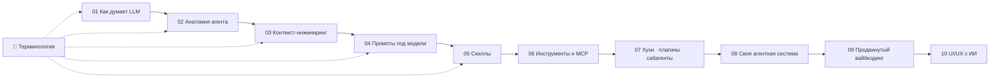

# 🧭 AI Agent Systems — карта курса

> [!abstract] О чём курс
> Как устроен ИИ-агент изнутри, как им управлять и как собрать свою агентную систему: промпты, контекст, скиллы, инструменты, MCP, хуки, плагины, сабагенты. Плюс финальный модуль для опытных: как сейчас строят проекты в паре с ИИ и как делать нормальный UI/UX без «ИИ-шаблонности».
>
> **Чего здесь нет:** математики трансформеров, обучения моделей и привязки к одному языку программирования. Нужно ровно столько теории про LLM, чтобы понимать, *почему* агент ведёт себя так, а не иначе.

---

## 🗺️ Маршрут

| # | Модуль | Ты научишься | Уровень |
|---|--------|--------------|---------|
| 01 | [[01 Как думает LLM]] | понимать, откуда берутся галлюцинации, «забывчивость» и шаблонность | 🟢 |
| 02 | [[02 Анатомия агента]] | видеть агента как цикл «модель → инструмент → результат»; разбирать 120-строчный агент | 🟢 |
| 03 | [[03 Контекст-инжиниринг]] | решать, что агент видит, когда и сколько это стоит | 🟡 |
| 04 | [[04 Промпты для разных моделей]] | писать системные промпты для Claude, GPT, Gemini и открытых моделей | 🟡 |
| 05 | [[05 Скиллы]] | писать скиллы, которые срабатывают вовремя и выполняются одинаково | 🟡 |
| 06 | [[06 Инструменты и MCP]] | проектировать инструменты, понимать MCP и его риски | 🟡 |
| 07 | [[07 Хуки, плагины, сабагенты]] | выносить жёсткие правила в хуки, делить работу между сабагентами, упаковывать всё в плагин | 🟠 |
| 08 | [[08 Собираем свою агентную систему]] | спроектировать и собрать свой харнесс от ядра до продакшена | 🟠 |
| 09 | [[09 Продвинутый вайбкодинг]] | применять паттерны опытных агентных инженеров | 🔴 |
| 10 | [[10 UI-UX с ИИ]] | получать от ИИ интерфейсы с собственным характером | 🔴 |
| 📖 | [[11 Терминология]] | — держи открытым, пока читаешь | все |
| 🔗 | [[12 Библиотека ссылок]] | первоисточники: документация, статьи, репозитории | все |

**Практика:** папка `code/` — рабочий мини-агент на Python без зависимостей (проверен тестом), `templates/` — заготовки скилла, `AGENTS.md`, системного промпта, `DESIGN.md` и хука.

---

## 👣 Как проходить

> [!tip] Новичок
> Читай по порядку 01 → 08. Незнакомое слово ищи в [[11 Терминология]]. В конце каждого модуля есть **🧪 Практика** — не пропускай её: понимание агентов появляется после 2–3 часов работы с живым агентом, а не после чтения.

> [!tip] Уже вайбкодишь
> Пробеги 01–03 по чек-листам (5 минут на модуль), затем 05 → 07 → 09 → 10. В 08 смотри разделы «Архитектура» и «Долгие задачи».

> [!example] Нужен минимум инструментов
> Любой агентный CLI: **Claude Code**, **Codex CLI**, **Gemini CLI**, **OpenCode** или **Hermes**. Принципы одинаковые; там, где различаются детали (хуки, плагины), курс показывает их на Claude Code, потому что у него самая полная публичная документация.

---

## 🧠 Главное за одну минуту

1. **LLM предсказывает следующий токен.** Она не «знает» и не «помнит»: она продолжает текст, который видит. Всё управление агентом — это управление тем, что модель видит.
2. **Агент = модель в цикле с инструментами.** Модель предлагает действие, код его выполняет, результат возвращается в контекст. Повторять до готовности.
3. **Контекст — бюджет, а не склад.** Чем он длиннее, тем хуже модель замечает важное. Хорошая система грузит знания по требованию.
4. **Промпт задаёт поведение, хук его гарантирует.** То, что обязано выполняться всегда, должно жить в коде, а не в просьбе.
5. **Скилл — упакованная процедура.** Короткое описание видно всегда, полный текст — только когда нужен.
6. **Агент хорош настолько, насколько хорош его способ проверить себя.** Тесты, типы, линтер, скриншот, ревьюер с чистым контекстом.
7. **Исправляй систему, а не результат.** Агент ошибся дважды одинаково → правка в `AGENTS.md`, скилле или хуке, а не ручная правка кода.

---

## ✅ Итоговый чек-лист курса

- [ ] Могу объяснить, что происходит за один шаг агентного цикла
- [ ] Запустил `code/mini_agent.py` и добавил свой инструмент
- [ ] Написал `AGENTS.md` для своего проекта (≤ 150 строк)
- [ ] Написал скилл, который сам срабатывает на нужной фразе и не срабатывает на чужих
- [ ] Поставил хук, который блокирует опасную команду
- [ ] Подключил MCP-сервер и понимаю, какие данные он может унести
- [ ] Провёл фичу по циклу «допрос → спека → тикеты → реализация → независимое ревью»
- [ ] Сделал экран, который не выглядит как «очередной ИИ-лендинг»
