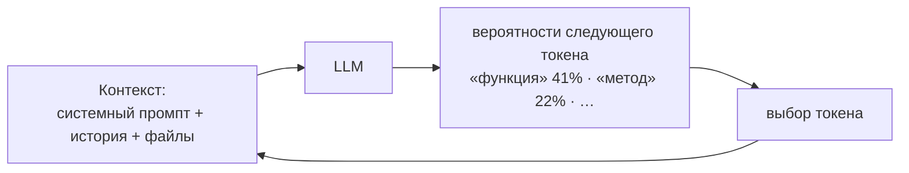

# 01 · Как думает LLM (без математики)

> [!abstract] 🎯 Что вынесешь
> Пять свойств LLM, из которых следует почти всё странное поведение агентов: галлюцинации, «забывание» инструкций, шаблонные решения, зацикливание и уверенный тон при ошибке. Для каждого свойства — что с ним делать на практике.

---

## 1. Модель продолжает текст

LLM получает на вход последовательность **токенов** (кусочков слов) и выдаёт распределение вероятностей для следующего токена. Выбирает один, дописывает, повторяет. Всё.

**Следствия, которые нужно запомнить:**

| Свойство | Что это значит для тебя |
|----------|-------------------------|
| Модель не «знает», а продолжает правдоподобно | Галлюцинация — нормальная работа модели в условиях нехватки данных. Лечится доступом к фактам (прочитать файл, поискать), а не просьбой «не выдумывай». |
| У модели нет памяти между вызовами | Всё, что агент «помнит», лежит в контексте или в файлах, которые он перечитывает. API каждый раз получает всю историю заново. |
| Модель видит только контекст | Если правило не попало в контекст в нужный момент — его не существует. |
| Ответ строится токен за токеном | Ранние слова ответа направляют поздние. Поэтому «сначала план, потом код» работает: план становится частью контекста. |

> [!example] Токены на пальцах
> Английский текст: ~4 символа на токен. Русский: обычно дороже — 1 слово ≈ 2–3 токена. Код с отступами тоже «ест» токены. Это важно для бюджета: тот же промпт на русском заметно дороже и быстрее заполняет окно.

---

## 2. Окно контекста — это бюджет внимания

**Окно контекста** — максимум токенов, которые модель видит за раз (сейчас обычно от 128K до 1M+). Но «влезает» не значит «работает».

- Исследование Chroma *Context Rot* (18 моделей): качество падает задолго до заполнения окна, особенно когда рядом много похожих, но нерелевантных фрагментов.
- Anthropic формулирует цель так: найти **наименьший набор высокосигнальных токенов**, который максимизирует шанс нужного результата.
- Практическое наблюдение команд, строящих агентов: важное в середине длинного контекста замечается хуже, чем в начале и в конце.

> [!warning] Ловушка «засунуть всё»
> 3000-строчный `AGENTS.md`, 40 подключённых MCP-серверов, полный лог тестов в истории — и агент начинает «забывать» простые правила. Это не глупость модели, это шум в контексте. Подробно — [[03 Контекст-инжиниринг]].

---

## 3. Сэмплинг: почему один и тот же промпт даёт разные ответы

Из распределения вероятностей токен выбирается с долей случайности. Её регулируют **temperature**, **top-p**, **top-k**.

- Низкая температура → предсказуемее, но шаблоннее. Высокая → разнообразнее, но больше ошибок.
- У современных «думающих» моделей параметры сэмплинга часто лучше **не трогать**. Например, Google прямо рекомендует держать для Gemini 3 значения по умолчанию: снижение temperature ниже 1.0 может вызвать зацикливание и деградацию на задачах с рассуждением.
- Агенту нужна не одинаковость ответа, а **одинаковость процесса**: те же шаги, те же проверки. Это достигается скиллами, чек-листами и хуками, а не температурой.

---

## 4. Шаблонность: модель тянется к «среднему по интернету»

Модель обучена на огромном корпусе и по умолчанию выбирает самый вероятный вариант. Anthropic называет это **distributional convergence** — схождением к распределению.

Отсюда:
- шрифт Inter, фиолетовый градиент и карточки в карточках в каждом ИИ-интерфейсе ([[10 UI-UX с ИИ]]);
- одинаковая структура «Введение — 3 пункта — Заключение» в текстах;
- популярная, но не подходящая твоему проекту библиотека.

**Как бороться:** давать конкретику, которой нет «в среднем» — свой дизайн-токен, свой стиль кода, примеры из своего репозитория, явные ограничения. Абстрактное «сделай красиво/качественно» не сдвигает модель с середины распределения.

---

## 5. Рассуждение (thinking / reasoning effort)

Современные модели умеют «думать» перед ответом: генерируют скрытые рассуждения, а потом ответ. Обычно этим управляют параметром **effort / reasoning_effort / thinking budget**.

| Effort | Когда | Цена |
|--------|-------|------|
| низкий | механические правки, поиск, форматирование | быстро, дёшево |
| средний | обычная разработка, большинство задач агента | баланс |
| высокий / max | архитектура, тяжёлый баг, ревью безопасности | медленно, дорого |

> [!tip] Правило большого пальца
> Не лечи плохой промпт высоким effort. OpenAI отмечает: GPT-5 тратит токены рассуждения, пытаясь **примирить противоречивые инструкции**, вместо того чтобы просто выбрать одну. Противоречие в промпте = прямые потери денег и качества.

---

## 6. Обучение и «характер» модели

Поверх базового предсказания текста модель дообучена следовать инструкциям, вызывать инструменты и вести себя как помощник (RLHF и аналоги). Поэтому:

- **Разные семейства по-разному читают промпты.** Одни исполняют буквально, другие — по духу; одни многословны, другие лаконичны. → [[04 Промпты для разных моделей]]
- **Модель хочет закончить задачу.** Отсюда «преждевременное завершение»: объявить готовность, не проверив. Лечится явным критерием готовности и внешней проверкой.
- **Модель хочет угодить.** Согласится с неверной идеей, подгонит код под тест. Лечится отдельным ревьюером и формулировками вида «если тест неверен — скажи, а не обходи его».
- **У модели есть дата отсечения знаний.** Про новые версии библиотек она знает мало или неверно. Лечится документацией в контексте (`llms.txt`, MCP документации, ссылка на changelog).

---

## 🧩 Шпаргалка: симптом → причина → лечение

| Симптом | Причина | Лечение |
|---------|---------|---------|
| Выдумал API или функцию | нет фактов в контексте | дать инструмент поиска/чтения; правило «сначала открой файл» |
| Забыл правило из начала | длинный, шумный контекст | короче системный промпт, скилл по требованию, свежая сессия |
| Каждый раз по-разному | нет зафиксированного процесса | скилл с шагами и критериями готовности |
| «Готово!», но не работает | преждевременное завершение | проверка в цикле: тесты, скриншот, отдельный ревьюер |
| Шаблонный дизайн/код | схождение к среднему | конкретные токены, примеры, запреты на клише + позитивная цель |
| Зациклился на одной ошибке | загрязнённый контекст | новая сессия с кратким handoff-документом |
| Подогнал код под тест | желание «пройти» | «тесты проверяют, а не определяют решение» + ревью |

---

## 🧪 Практика (20 минут)

1. Задай любой модели один и тот же вопрос 3 раза в новых чатах. Сравни: что стабильно, что плавает?
2. Попроси написать функцию для библиотеки, которая вышла недавно. Затем вставь кусок свежей документации и попроси снова. Сравни.
3. Дай модели два противоречивых требования («всегда отвечай одним словом» + «подробно объясни»). Посмотри, как она выкручивается. Это и есть цена противоречий.

## ✅ Чек-лист

- [ ] Объясняю, почему галлюцинация — следствие продолжения текста, а не «баг»
- [ ] Понимаю, что агент «помнит» только то, что в контексте и в файлах
- [ ] Знаю, почему длинный контекст ухудшает качество
- [ ] Не трогаю temperature у думающих моделей без причины
- [ ] Умею выбрать effort под задачу

---
← [[00 Старт — карта курса]] · → [[02 Анатомия агента]] · 📖 [[11 Терминология]]
