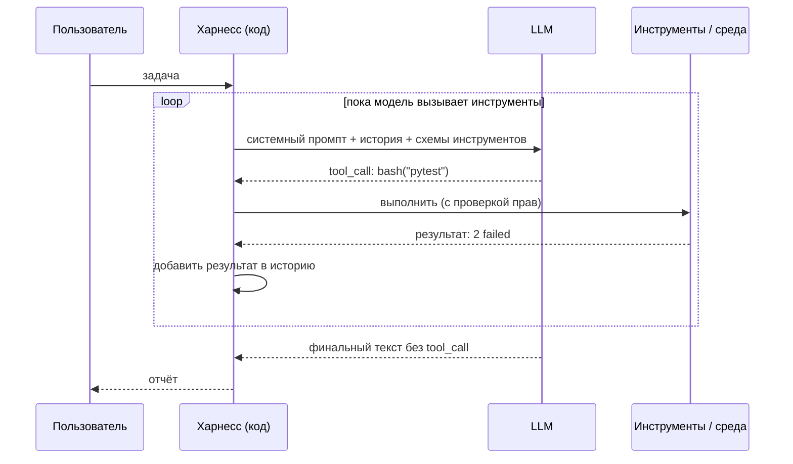
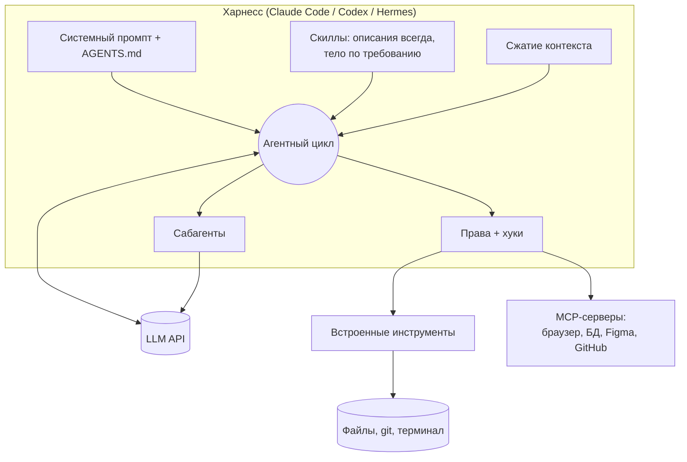

# 02 · Анатомия агента

> [!abstract] 🎯 Что вынесешь
> Агент — это не магия, а цикл в ~100 строк кода. Ты разберёшь его по частям, поймёшь, что такое **харнесс**, и увидишь, чем Claude Code отличается от твоего скрипта (спойлер: обвязкой, а не сутью).

---

## 1. Формула

> **Агент = LLM + инструменты + цикл + среда + правила остановки**



Модель **никогда сама ничего не выполняет.** Она возвращает структурированную просьбу «вызови `bash` с аргументом `pytest`». Выполняет — харнесс. Поэтому безопасность, лимиты и логирование всегда живут в харнессе.

---

## 2. Части агента

| Часть | Что это | Пример в Claude Code / Codex |
|-------|---------|------------------------------|
| **Модель** | «мозг», который выбирает следующее действие | Claude, GPT, Gemini, Qwen… |
| **Системный промпт** | постоянные инструкции: роль, правила, стиль | встроенный промпт CLI + `CLAUDE.md` / `AGENTS.md` |
| **Инструменты (tools)** | функции со схемой, которые модель может «попросить» | Read, Edit, Bash, Grep, WebFetch, MCP-инструменты |
| **Цикл (agent loop)** | «вызов модели → выполнение → результат → снова модель» | ядро любого CLI-агента |
| **Среда** | где выполняются действия | твоя папка, контейнер, git worktree, браузер |
| **Память** | что переживает сессию | файлы `AGENTS.md`, заметки, базы знаний |
| **Управление контекстом** | обрезка, сжатие, подгрузка по требованию | auto-compact, скиллы, сабагенты |
| **Права и защита** | что можно без спроса, что нельзя | режимы разрешений, хуки, песочница |
| **Остановка** | когда цикл заканчивается | модель ответила текстом / лимит шагов / человек |

> [!info] Харнесс (harness)
> Всё, кроме модели. Буквально «упряжь»: код, который запрягает модель в работу. Claude Code, Codex CLI, Cursor, Hermes — это харнессы. Одна и та же модель в разных харнессах работает очень по-разному: качество агента часто определяется харнессом не меньше, чем моделью.

---

## 3. Разбор живого кода

В папке курса лежит `code/mini_agent.py` — 120 строк на Python без зависимостей. Он работает с любым OpenAI-совместимым API, включая локальные модели (Ollama, LM Studio, llama.cpp). Тест `code/test_mini_agent.py` прогоняет цикл на фейковом сервере без трат.

### 3.1 Инструмент = схема + реализация

```python
{"type": "function", "function": {
    "name": "read_file",
    "description": "Read a UTF-8 text file. Use before editing or answering about a file.",
    "parameters": {"type": "object", "properties": {
        "path": {"type": "string", "description": "Path relative to the working dir"}},
        "required": ["path"]}}}
```

Модель видит **только** имя, описание и схему. Описание — это промпт: «Use before editing» учит модель, *когда* вызывать инструмент.

### 3.2 Цикл

```python
for step in range(1, MAX_STEPS + 1):
    msg = call_llm(messages)
    messages.append(msg)
    calls = msg.get("tool_calls") or []
    if not calls:                       # модель ответила текстом → закончила
        return msg.get("content")
    for c in calls:
        result = run_tool(c["function"]["name"], json.loads(c["function"]["arguments"]))
        messages.append({"role": "tool", "tool_call_id": c["id"], "content": result})
```

Это и есть агент. Всё остальное в больших CLI — улучшения вокруг этих 8 строк.

### 3.3 Три детали, которые отличают рабочего агента от игрушки

1. **Ошибка инструмента возвращается модели текстом, а не роняет программу.** `ERROR: FileNotFoundError: src/app.py` — модель прочитает и попробует `ls`. Это самовосстановление.
2. **Длинный вывод обрезается.** 50 000 строк лога убьют контекст. Claude Code по умолчанию ограничивает ответ инструмента 25 000 токенов.
3. **Опасные действия требуют подтверждения.** `rm`, `git push`, `sudo` — спросить человека. В больших системах это делают режимы разрешений и хуки ([[07 Хуки, плагины, сабагенты]]).

---

## 4. Workflow или агент?

Anthropic в «Building Effective Agents» разделяет:

- **Workflow** — LLM и инструменты связаны **заранее прописанным кодом** путём. Предсказуемо, дёшево, легко тестировать.
- **Agent** — LLM **сама решает**, какой следующий шаг сделать. Гибко, но дороже и менее предсказуемо.

Главный совет оттуда же: начинай с самого простого решения и усложняй, только когда это даёт измеримый выигрыш.

### Пять проверенных паттернов (от простого к сложному)

| Паттерн | Суть | Пример |
|---------|------|--------|
| **Prompt chaining** | шаг 1 → проверка → шаг 2 | план → проверка плана кодом → реализация |
| **Routing** | классификатор отправляет задачу по нужной ветке | «вопрос по оплате» → дешёвая модель + база FAQ |
| **Parallelization** | несколько вызовов параллельно, потом сбор | 3 ревьюера (безопасность, производительность, стиль) |
| **Orchestrator–workers** | главный агент раздаёт подзадачи сабагентам | исследование: оркестратор + поисковые агенты |
| **Evaluator–optimizer** | один генерирует, другой оценивает, цикл | код ↔ ревьюер, текст ↔ критик |

> [!tip] Как выбирать
> Можешь нарисовать путь блок-схемой заранее → **workflow**. Путь зависит от того, что найдётся по дороге (баги, поиск, исследование) → **агент**. Большинство реальных систем — агент с вкраплениями workflow (например, обязательный прогон тестов после правки).

---

## 5. Как это выглядит в больших системах



Каждый блок этой схемы — отдельный модуль курса.

---

## 🧩 Ошибки новичка

| Ошибка | Почему плохо | Как правильно |
|--------|-------------|---------------|
| Строить мультиагентную систему с первого дня | дорого и хрупко, сложно отлаживать | один агент + хорошие инструменты; сабагенты — когда упрёшься |
| Давать агенту 30 инструментов «на всякий случай» | модель путается, контекст пухнет | 3–10 хорошо описанных инструментов |
| Не ставить лимит шагов | бесконечный цикл и счёт за API | `MAX_STEPS`, таймауты, бюджет |
| Падать на ошибке инструмента | агент теряет шанс исправиться | ошибка → текст → модели |
| Читать только ответ, не логи | не видишь, *как* агент пришёл к ответу | логируй каждый tool call |

---

## 🧪 Практика (40 минут)

1. Запусти тест: `python3 code/test_mini_agent.py` → должно быть `OK`.
2. Запусти агента на реальной модели (инструкция в начале файла). Дай задачу: «Посчитай строки кода в этой папке по расширениям и запиши в stats.md».
3. Добавь свой инструмент `list_dir(path)`. Посмотри, перестала ли модель вызывать `bash ls`.
4. Испорти описание инструмента (сделай его пустым). Сравни поведение. Это наглядно показывает, что описание инструмента — тоже промпт.

## ✅ Чек-лист

- [ ] Рисую агентный цикл по памяти
- [ ] Объясняю, что модель не выполняет действия сама
- [ ] Отличаю workflow от агента и знаю 5 паттернов
- [ ] Понимаю, что такое харнесс и почему он важен не меньше модели

---
← [[01 Как думает LLM]] · → [[03 Контекст-инжиниринг]] · 📖 [[11 Терминология]]
