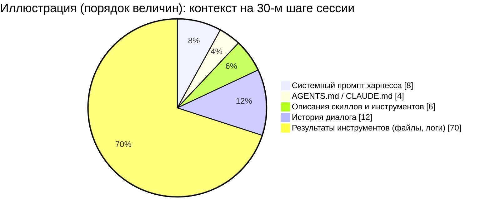
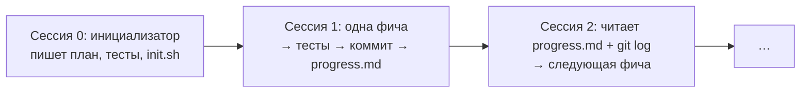

# 03 · Контекст-инжиниринг

> [!abstract] 🎯 Что вынесешь
> Промпт-инжиниринг — про формулировку одной просьбы. **Контекст-инжиниринг** — про то, *что вообще попадает в окно модели на каждом шаге*: инструкции, файлы, результаты инструментов, история, память. Для агентов это главный навык.

> [!quote] Anthropic, «Effective context engineering for AI agents»
> Хорошая инженерия контекста — это поиск наименьшего набора высокосигнальных токенов, который максимизирует вероятность нужного результата.

---

## 1. Из чего состоит контекст агента



Обрати внимание: основной «съедатель» контекста — **результаты инструментов**, а не твои промпты. Управлять нужно прежде всего ими.

---

## 2. Четыре рычага

| Рычаг | Вопрос | Инструменты |
|-------|--------|-------------|
| **Отбор** (select) | Что действительно нужно на этом шаге? | поиск по требованию, `grep` вместо чтения всего файла, скиллы |
| **Сжатие** (compress) | Можно ли сказать то же короче? | лаконичные ответы инструментов, compaction, сводки |
| **Изоляция** (isolate) | Можно ли вынести «шумную» работу? | сабагенты, отдельные сессии, worktree |
| **Запись наружу** (write) | Что должно пережить сессию? | файлы прогресса, `PLAN.md`, git-коммиты, память |

---

## 3. Принципы, которые работают

### 3.1 Правильная «высота» инструкций

Anthropic описывает две крайности системного промпта:
- **слишком низко** — хрупкие if-else правила для каждого случая;
- **слишком высоко** — расплывчатое «будь полезным», которое ничего не говорит.

Нужна середина: **конкретные эвристики и принципы**, из которых модель сама выведет поведение в новых ситуациях.

| ❌ Слишком низко | ❌ Слишком высоко | ✅ Правильно |
|------------------|-------------------|--------------|
| «Если файл .ts и в нём есть `any` и это не тест — замени на `unknown`, если …» | «Пиши качественный код» | «Типы — граница доверия: на входе из сети валидируем через zod, внутри модулей доверяем типам. `any` допустим только в тестах.» |

### 3.2 Just-in-time вместо «загрузить всё»

Агент держит в контексте **указатели** (пути файлов, названия скиллов, ссылки), а содержимое достаёт инструментами, когда нужно. Так работает Claude Code: вместо индекса всего репозитория — `grep`, `glob`, `read`.

### 3.3 Прогрессивное раскрытие

Знания лежат «этажами»:

```
Уровень 1: название + описание скилла   ~100 токенов   → всегда в контексте
Уровень 2: тело SKILL.md                 < 5000 токенов → когда скилл активирован
Уровень 3: references/, scripts/          сколько угодно → когда нужен конкретный файл
```

Подробно — [[05 Скиллы]].

### 3.4 Ответы инструментов — тоже промпт

- Возвращай **осмысленные** поля, а не технические ID: `name`, `status`, а не `uuid`, `mime_type`.
- Делай **пагинацию, фильтры, обрезку** по умолчанию.
- Ошибка должна подсказывать, что делать: `"Файл не найден. Похожие: src/app.tsx, src/App.ts"`.

### 3.5 Код вместо сотни вызовов

Anthropic в «Code execution with MCP»: если агент пишет код, который сам вызывает инструменты и фильтрует данные, а в контекст возвращается только итог, расход в их примере падает со 150 000 до 2 000 токенов (−98.7%). Мораль: для массовой обработки данных дай агенту **песочницу с кодом**, а не тысячу вызовов инструментов.

---

## 4. Память агента: где что хранить

| Слой | Живёт | Что класть | Пример |
|------|-------|-----------|--------|
| Системный промпт харнесса | всегда | роль, безопасность, общий стиль | встроен в CLI |
| `AGENTS.md` / `CLAUDE.md` | каждый запуск в проекте | команды сборки, конвенции, структура, «всегда делай X» | `pnpm test`, «не трогай `/generated`» |
| Правила по путям (`.claude/rules/`, вложенные `AGENTS.md`) | при работе с этими файлами | правила одной части кода | правила для `api/` |
| Скиллы | по требованию | процедуры, справочники | «как делать релиз», «стиль API» |
| Файлы задачи | эта задача | план, прогресс, решения | `PLAN.md`, `progress.md`, `tests.json` |
| Git | навсегда | что сделано и почему | коммиты, PR |
| Долгая память | между сессиями | факты о пользователе и среде | «пользователь пишет на русском» |

> [!tip] Правило Claude Code для CLAUDE.md
> Держи там только факты, нужные в **каждой** сессии: команды, конвенции, структура, правила «всегда делай X». Многошаговая процедура или правило для одной части кода → в скилл или правило по пути. Противоречащие инструкции модель может разрешить произвольно — периодически чисти файл.

### Шаблон `AGENTS.md`

Готовый файл — `templates/AGENTS.md`. Суть:

```markdown
# Project: <название> — одна строка, что это и для кого
## Commands
- install: pnpm i · dev: pnpm dev · test: pnpm test · lint+types: pnpm check
## Layout
- src/api — HTTP-слой, только валидация и вызов сервисов
- src/core — бизнес-логика, без IO
## Conventions
- Ошибки: Result<T, E>, исключения только на границах
## Definition of done
- pnpm check зелёный · новые ветки покрыты тестом · UI проверен скриншотом
## Never
- не редактируй src/generated/** (генерируется `pnpm gen`)
```

`AGENTS.md` — открытый формат, его читают Codex, Cursor, Gemini CLI, Jules, Aider, Zed и другие (больше 60 тыс. проектов на GitHub). Claude Code читает `CLAUDE.md`; чтобы не дублировать, сделай `CLAUDE.md` с одной строкой `@AGENTS.md` (импорт) или симлинк.

---

## 5. Долгие задачи: когда контекст кончается

Две проблемы, которые Anthropic описывает в «Effective harnesses for long-running agents»:
1. агент пытается сделать **всё сразу** и выдыхается на середине, оставляя полуготовую фичу;
2. новая сессия видит прогресс и **объявляет задачу завершённой** раньше времени.

**Решение — «работа сменами»:**



- Первая сессия — особая: создаёт каркас, список фич, тесты (в структурированном виде, например `tests.json`), скрипт запуска.
- Каждая следующая: **прочитать состояние → сделать одну вещь → проверить → закоммитить → обновить прогресс**.
- Состояние: структурированное (JSON) — для статусов тестов, свободный текст — для заметок, git — для истории.
- Часто **новая сессия лучше сжатия**: современные модели хорошо восстанавливают картину по файлам.

> [!warning] Compaction ≠ память
> Автоматическое сжатие пересказывает историю и теряет детали. Всё критичное агент должен **записать в файл** до сжатия.

### Handoff-документ (передача смены)

```markdown
## Цель
## Что сделано (с коммитами)
## Текущее состояние: что работает / что сломано
## Принятые решения и почему
## Следующий шаг (один, конкретный)
## Подводные камни, на которые уже наступили
```

---

## 6. Признаки «загрязнённого» контекста

- агент повторяет одну и ту же неудачную попытку;
- путает старую и новую версию файла;
- начинает игнорировать правила из `AGENTS.md`;
- ответы становятся длиннее и расплывчатее.

**Лечение:** не спорить с агентом, а **начать новую сессию** с handoff-документом. Это дешевле, чем 20 минут уговоров.

---

## 🧪 Практика (30 минут)

1. Открой свой `AGENTS.md`/`CLAUDE.md` (или создай из `templates/AGENTS.md`). Вычеркни всё, что модель и так делает по умолчанию. Перенеси процедуры в будущие скиллы.
2. Проведи длинную сессию до ощутимой деградации. Попроси агента написать handoff, начни новую сессию с ним. Сравни качество.
3. Найди в своих инструментах (или MCP) тот, что возвращает больше всего мусора. Подумай, какие поля и фильтры ему нужны.

## ✅ Чек-лист

- [ ] Знаю 4 рычага: отбор, сжатие, изоляция, запись наружу
- [ ] Мой `AGENTS.md` короткий и без очевидностей
- [ ] Для долгих задач веду файл прогресса и коммичу по шагам
- [ ] Перезапускаю сессию вместо борьбы с загрязнённым контекстом

---
← [[02 Анатомия агента]] · → [[04 Промпты для разных моделей]] · 📖 [[11 Терминология]]
