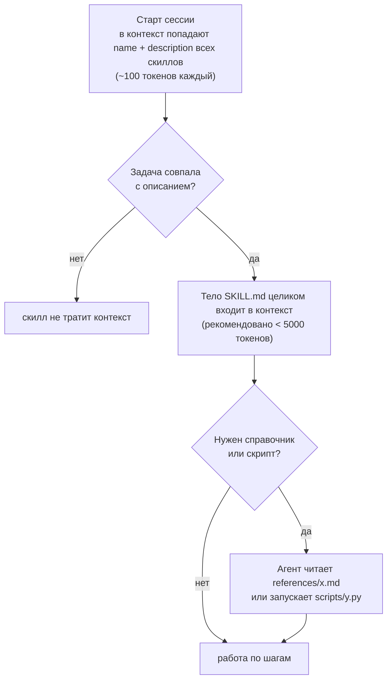

# 05 · Скиллы

> [!abstract] 🎯 Что вынесешь
> Что такое скилл, как он загружается, как написать **описание**, по которому агент сам находит скилл, и **тело**, по которому он каждый раз проходит один и тот же процесс. Плюс 12 приёмов авторов лучших публичных скиллов и чек-лист ревью.

> [!quote] Главная мысль
> Скилл существует, чтобы выжать **предсказуемость** из вероятностной системы. Не одинаковый результат, а одинаковый *процесс* при каждом запуске.

---

## 1. Что такое скилл

**Скилл** — папка с файлом `SKILL.md` (инструкции + метаданные) и, по желанию, скриптами, справочниками и шаблонами. Формат открытый — **Agent Skills** ([agentskills.io](https://agentskills.io/specification)). Его понимают Claude Code, Codex, Cursor, Gemini CLI, OpenCode, Hermes и другие.

```
release-notes/
├── SKILL.md          # обязательно: frontmatter + инструкции
├── scripts/          # исполняемые помощники (детерминированная работа)
│   └── collect_commits.py
├── references/       # справочники, грузятся по требованию
│   └── style-guide.md
└── assets/           # шаблоны, примеры, картинки
    └── template.md
```

### Чем скилл отличается от остального

| Механизм | Когда загружается | Для чего |
|----------|-------------------|----------|
| `AGENTS.md` | всегда | факты и правила для каждой сессии |
| **Скилл** | описание — всегда, тело — по требованию | процедуры, справочники, повторяемые задачи |
| Сабагент | при запуске, в отдельном контексте | изолировать «шумную» работу |
| Хук | на событие, вне модели | то, что обязано выполняться всегда |
| MCP | имена инструментов сразу, схемы по требованию | доступ к внешним системам |

> [!tip] Когда рождается скилл
> Хороший триггер из документации Claude Code: ты **в третий раз** вставляешь в чат одну и ту же инструкцию или чек-лист → это скилл. Повторяешь один и тот же стартовый промпт → скилл, вызываемый вручную.

---

## 2. Как скилл загружается: прогрессивное раскрытие



**Следствие:** описание — самая дорогая часть скилла (висит в контексте всегда, у всех скиллов сразу) и самая важная (по нему решается, сработает ли скилл).

---

## 3. Frontmatter

```yaml
---
name: release-notes
description: Draft release notes from merged PRs and commits since the last tag. Use when the user asks for release notes, a changelog entry, or "what shipped" for a version.
---
```

| Поле | Правило (спецификация Agent Skills) |
|------|--------------------------------------|
| `name` | 1–64 символа, `a-z 0-9 -`, без `--`, не начинается и не заканчивается дефисом, **совпадает с именем папки** |
| `description` | 1–1024 символа: **что делает + когда использовать** + ключевые слова |
| `license`, `compatibility`, `metadata` | опционально |
| `allowed-tools` | опционально, экспериментально: заранее разрешённые инструменты |

**Расширения Claude Code** (другие харнессы их проигнорируют):

| Поле | Что даёт |
|------|----------|
| `disable-model-invocation: true` | скилл вызывается **только вручную** через `/name`; описание не тратит контекст модели |
| `user-invocable: false` | скрыт из меню `/`, только для модели (фоновое знание) |
| `when_to_use` | доп. триггеры; вместе с description обрезается до 1536 символов |
| `paths` | автозагрузка только при работе с файлами по glob-маске |
| `context: fork` + `agent` | выполнить скилл в отдельном сабагенте |
| `model`, `effort` | своя модель и глубина рассуждения на время скилла |
| `hooks` | хуки, которые включаются при запуске скилла |
| `arguments`, `$ARGUMENTS`, `${CLAUDE_SKILL_DIR}` | параметры и пути внутри скилла |

---

## 4. Описание: пишем так, чтобы скилл срабатывал вовремя

### Формула

> **[Что делает, глаголами] + Use when [конкретные ситуации и слова пользователя]**

| ❌ Плохо | ✅ Хорошо |
|---------|----------|
| `Helps with PDFs.` | `Extract text and tables from PDFs, fill forms, merge files. Use when working with PDF documents or when the user mentions PDFs, forms, or document extraction.` |
| `Code review skill` | `Review a diff for bugs, security and missing tests. Use when the user asks to review changes, a PR, or "check my code" before commit.` |
| `Useful for frontend` | `Build distinctive, production-grade UI. Use when creating pages, components or redesigns; not for backend-only changes.` |

### Правила

1. **Ведущее слово — в начало.** Первые слова решают больше всего; в листинге длинные описания обрезаются.
2. **Одна ветка — один триггер.** Синонимы одного и того же случая — это дублирование, оно ест контекст и не добавляет срабатываний.
3. **Третье лицо, без «я»/«ты».** Описание читает модель в списке скиллов.
4. **Отделяй соседей.** Если есть `code-review` и `security-review`, в описании явно скажи, чем они отличаются, иначе агент будет путать.
5. **Проверь на ложные срабатывания.** Придумай 5 фраз, где скилл нужен, и 5, где нет. Прогони.

---

## 5. Тело: шаги + справка

Тело строится из двух типов содержимого:

- **Шаги** — упорядоченные действия. Каждый шаг заканчивается **проверяемым критерием готовности**.
- **Справка** — правила, определения, факты, к которым агент обращается по ходу.

### Лестница размещения информации

```
1. Шаг в SKILL.md           — то, что агент делает, по порядку        (нужно в каждом запуске)
2. Справка в SKILL.md       — правила, которые нужны почти всегда
3. Внешний файл references/ — то, что нужно лишь в некоторых ветках   (по указателю)
4. Скрипт в scripts/        — всё, что можно сделать детерминированно
```

**Тест для выноса в отдельный файл:** нужно ли это **каждому** запуску? Да → в `SKILL.md`. Только некоторым веткам → `references/` и чёткий указатель: «Если меняешь схему БД — прочитай `references/migrations.md`». Формулировка указателя решает, дойдёт ли агент до файла.

### Скелет

```markdown
---
name: release-notes
description: Draft release notes from merged PRs since the last tag. Use when the user asks for release notes, a changelog entry, or "what shipped".
---

# Release notes

## Steps
1. Find the last tag: `git describe --tags --abbrev=0`.
   Done when: you have a tag name, or confirmed there are no tags.
2. Collect changes: run `python ${CLAUDE_SKILL_DIR}/scripts/collect_commits.py <tag>`.
   Done when: every merged PR since the tag is in the list.
3. Group by user impact: Added / Changed / Fixed / Breaking.
   Done when: every item is in exactly one group; internal refactors are dropped.
4. Write using `assets/template.md`. Breaking changes include a migration line.
5. Show the draft. Do not create the tag or publish.

## Rules
- Write for users, not developers: "Exports are 3× faster", not "Refactor export worker".
- If a PR title is unclear, read the PR body before guessing.

## References
- Tone and examples: `references/style-guide.md` — read when unsure how to phrase an item.
```

Готовый шаблон: `templates/SKILL.md`.

---

## 6. Двенадцать приёмов авторов сильных скиллов

1. **Предсказуемость — главная цель.** Каждое правило должно делать процесс одинаковым от запуска к запуску.
2. **Проверяемый критерий готовности у каждого шага.** «Каждый изменённый файл учтён», а не «составь список изменений». Размытый критерий = преждевременное завершение.
3. **Ведущие слова (leading words).** Одно ёмкое понятие из «знаний» модели заменяет абзац: *tracer bullet*, *red/green*, *fog of war*, *tight loop*, *grilling*. Модель уже знает, что это значит, и подтягивает целое поведение. «Быстрый, детерминированный, дешёвый цикл» → *tight loop*.
4. **Тест на no-op.** Для каждого предложения спроси: изменит ли оно поведение по сравнению с поведением по умолчанию? «Будь внимателен» — no-op, удалить. Если правило нужно усилить — подбери слово сильнее (*relentless*), а не добавляй абзац.
5. **Позитивные формулировки.** «Не думай о слоне» делает слона доступнее. Описывай целевое поведение; запрет оставляй только как жёсткое ограничение — и сразу с альтернативой.
6. **Один источник правды.** Каждый смысл живёт в одном месте. Дубли раздувают вес правила и расходятся при правках.
7. **Детерминированное — в скрипты.** Парсинг, подсчёты, валидация, форматирование — в `scripts/`. Скрипт дешевле, точнее и не тратит контекст на объяснения.
8. **Скрипт отвечает понятной ошибкой.** `ERROR: no tags found. Run with --from <commit>` — агент исправится сам.
9. **Совместное размещение.** Определение, правила и оговорки одного понятия — под одним заголовком, а не по разным разделам.
10. **Дели по вызову или по последовательности.** Отдельный скилл — если у него своё ведущее слово и свой триггер. Разбить шаги на два скилла — если видимые следующие шаги заставляют агента торопиться с текущим.
11. **Правило, которое нельзя нарушать, — в хук.** Скилл — просьба. Если правило должно выполняться **каждый раз** (линтер после правки, запрет на `rm -rf`), вынеси его в хук, можно прямо во frontmatter скилла. Это рекомендация самой документации Claude Code.
12. **Обрезай осадок.** Скиллы обрастают устаревшими правилами, потому что добавлять «безопасно», а удалять «страшно». Раз в месяц: каждое ли правило ещё нужно?

> [!tip] Ручной или автоматический?
> **Автоматический** (model-invoked) — когда агент должен сам понять, что скилл нужен, или его вызывает другой скилл. Цена — описание в контексте каждого запроса.
> **Ручной** (`disable-model-invocation: true`) — для действий, которые запускаешь осознанно (`/deploy`, `/release`). Контекст не тратится, но помнить о скилле должен ты. Когда ручных скиллов станет больше, чем помнишь, — сделай **скилл-роутер**: один ручной скилл, который перечисляет остальные и когда какой брать.

---

## 7. Диагностика: почему скилл не работает

| Симптом | Причина | Лечение |
|---------|---------|---------|
| Скилл не срабатывает | описание размытое или без слов пользователя | добавь конкретные триггеры, «Use when…» |
| Срабатывает не там | описание слишком широкое, пересекается с соседом | сузь, разграничь с похожими |
| Пропускает шаги | нет критериев готовности, шаги «утонули» в справке | шаги наверх, критерий в конце каждого |
| Делает «Готово», не закончив | **преждевременное завершение** | сначала усиль критерий; если не помогает — раздели скилл |
| Иногда игнорирует правило | правило «попросили», а не обеспечили | хук |
| Тело огромное, агент теряется | **разрастание** | справку в `references/`, детерминированное в `scripts/` |
| Противоречит `AGENTS.md` | дублирование и расхождение | один источник правды |

---

## 8. Тестирование и итерации

1. **Сначала без скилла.** Дай агенту задачу и запиши, где он ошибся. Скилл должен лечить именно эти ошибки — иначе он будет описывать то, что модель и так делает.
2. **Набор сценариев.** 3–5 задач, где скилл должен сработать, и 3–5 похожих, где не должен.
3. **Читай траектории**, не только результат: какие файлы открыл, какие шаги пропустил.
4. **Правь по одному изменению.**
5. **Попроси агента** самого улучшить скилл после трудной задачи: «Что в скилле не хватило или мешало? Предложи минимальный diff». Так устроены самообучающиеся агенты вроде Hermes: после сложной задачи они правят свои скиллы сами.

Инструменты: `skill-creator` от Anthropic ([anthropics/skills](https://github.com/anthropics/skills)) — интерактивно создаёт скилл и гоняет evals; раздел [Evaluating skills](https://agentskills.io/skill-creation/evaluating-skills) на agentskills.io.

---

## 9. Где брать хорошие скиллы (и учиться на них)

| Источник | Что смотреть |
|----------|--------------|
| [anthropics/skills](https://github.com/anthropics/skills) | эталонные скиллы: docx/pdf/xlsx, frontend-design, skill-creator |
| [mattpocock/skills](https://github.com/mattpocock/skills) | маленькие композиционные инженерные скиллы: `grill-me`, `tdd`, `to-spec`, `to-tickets`, `diagnose` |
| [obra/superpowers](https://github.com/obra/superpowers) | целая методология разработки на скиллах: brainstorm → plan → subagent-driven development |
| [vercel-labs/agent-skills](https://github.com/vercel-labs/agent-skills) | доменные справочники (React/Next.js: ~70 правил по приоритету) |
| [skills.sh](https://skills.sh/) | каталог и установщик: `npx skills add <owner/repo>` |
| [impeccable](https://github.com/pbakaus/impeccable) | дизайн-скилл с командами и детерминированными проверками |

> [!danger] Безопасность
> Скилл может содержать скрипты, которые агент запустит с твоими правами, и инструкции, которые поменяют поведение агента. Ставь скиллы только из источников, которым доверяешь, и **читай `SKILL.md` и `scripts/` перед установкой**.

---

## 🧪 Практика (60 минут)

1. Выбери задачу, которую делаешь с ИИ хотя бы раз в неделю. Запиши, где агент без скилла ошибается.
2. Напиши скилл по шаблону `templates/SKILL.md`: описание с триггерами, 3–6 шагов с критериями готовности, детерминированную часть — в скрипт.
3. Проверь срабатывание на 5 «да» и 5 «нет» фразах.
4. Пройди по телу тестом no-op и вычеркни всё, что не меняет поведение.

## ✅ Чек-лист ревью скилла

- [ ] `name` совпадает с папкой, формат по спецификации
- [ ] Описание: что делает + когда, ведущее слово в начале, без синонимов-дублей
- [ ] Каждый шаг заканчивается проверяемым критерием
- [ ] Тело < 500 строк; ветвящаяся справка в `references/` с чёткими указателями
- [ ] Детерминированная работа — в `scripts/`, ошибки скриптов понятны
- [ ] Нет no-op фраз, нет дублей с `AGENTS.md`
- [ ] Запреты переформулированы позитивно или подкреплены хуком
- [ ] Протестирован на срабатывание и на ложные срабатывания

---
← [[04 Промпты для разных моделей]] · → [[06 Инструменты и MCP]] · 📖 [[11 Терминология]]
