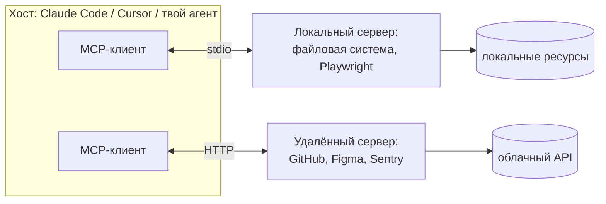

# 06 · Инструменты и MCP

> [!abstract] 🎯 Что вынесешь
> Как проектировать инструменты, которыми агент пользуется правильно с первого раза; что такое MCP и как подключать серверы; главные риски — **prompt injection** и **смертельная триада**.

> [!quote] Anthropic, «Building Effective Agents»
> Работая над агентом для SWE-bench, мы потратили больше времени на оптимизацию инструментов, чем на общий промпт.

---

## 1. Инструмент глазами модели

Модель видит инструмент как **имя + описание + JSON-схему параметров**. Больше ничего. Значит, проектирование инструмента — это наполовину промптинг.

Хороший инструмент — как хорошая функция для джуниора, который не может задать вопрос:

```json
{
  "name": "search_issues",
  "description": "Search project issues by text. Returns up to `limit` issues with id, title, status, assignee. Use to find existing bugs before creating a new one. For one issue by id use get_issue.",
  "input_schema": {
    "type": "object",
    "properties": {
      "query":  {"type": "string", "description": "Free text, e.g. 'login timeout safari'"},
      "status": {"type": "string", "enum": ["open", "closed", "any"], "default": "open"},
      "limit":  {"type": "integer", "minimum": 1, "maximum": 50, "default": 10}
    },
    "required": ["query"]
  }
}
```

---

## 2. Восемь правил проектирования инструментов

| # | Правило | Плохо | Хорошо |
|---|---------|-------|--------|
| 1 | **Инструмент под задачу агента, а не под API** | `list_users`, `list_events`, `create_event` | `schedule_meeting(attendees, duration)` — находит слот сам |
| 2 | **Пространства имён** | `search` в трёх серверах | `github_search_issues`, `jira_search_issues` |
| 3 | **Осмысленный ответ** | `{"uuid":"8f3a…","mime":"image/png"}` | `{"name":"logo.png","size":"24 KB","url":…}` |
| 4 | **Экономия токенов** | весь лог на 2 МБ | пагинация, фильтры, обрезка, `response_format: concise/detailed` |
| 5 | **Ошибка = подсказка** | `Error 400` | `"date must be YYYY-MM-DD, got '12/05'"` |
| 6 | **Защита от ошибок (poka-yoke)** | относительные пути, которые ломаются после `cd` | только абсолютные пути (так Anthropic починила ошибки в своём SWE-агенте) |
| 7 | **Описание отвечает на «когда»** | «Gets data» | «Use to … For X use Y instead» |
| 8 | **Мало, но хорошо** | 40 мелких инструментов | 5–10, которые закрывают реальные сценарии |

> [!tip] Как улучшать инструменты
> Прогони агента на 10–20 реальных задачах, собери логи вызовов и **дай их другой модели**: «Где агент ошибался с инструментами? Что поменять в описаниях и схемах?». Anthropic так и улучшает свои инструменты — с помощью Claude.

---

## 3. MCP — «USB-C для ИИ»

**Model Context Protocol** — открытый протокол, по которому агент (клиент) подключается к внешним системам (серверам). Один раз написанный MCP-сервер работает в Claude Code, Codex, Cursor, VS Code, Gemini CLI, Hermes и т. д.



### Что сервер даёт агенту

| Примитив | Что это | Пример |
|----------|---------|--------|
| **Tools** | действия, которые вызывает модель | `create_issue`, `browser_click`, `query_db` |
| **Resources** | данные, которые можно прочитать | файлы, записи БД, документы |
| **Prompts** | готовые шаблоны промптов | `/review-pr` из сервера |

Транспорт: **stdio** (сервер — локальный процесс) или **Streamable HTTP** (удалённый сервер, обычно с OAuth).

### Подключение (Claude Code)

```bash
# локальный сервер (stdio)
claude mcp add playwright -- npx @playwright/mcp@latest
# удалённый сервер (HTTP)
claude mcp add --transport http github https://api.githubcopilot.com/mcp/
```

Или в проекте — файл `.mcp.json` (коммитится в git, общий для команды). Другие клиенты используют похожий JSON-конфиг.

### MCP-серверы, которые стоит знать

| Сервер | Зачем |
|--------|-------|
| [Playwright MCP](https://github.com/microsoft/playwright-mcp) | агент управляет браузером: кликает, заполняет, проверяет свой UI |
| [Chrome DevTools MCP](https://github.com/ChromeDevTools/chrome-devtools-mcp) | консоль, сеть, производительность, скриншоты живой страницы |
| [Figma MCP](https://help.figma.com/hc/en-us/articles/32132100833559-Guide-to-the-Figma-MCP-server) | макеты, переменные и компоненты дизайн-системы прямо в контекст |
| GitHub MCP | issues, PR, ревью |
| Context7 и аналоги | свежая документация библиотек (лечит устаревшие знания модели) |
| Sentry / базы данных | реальные ошибки и данные, а не догадки |

> [!warning] Цена каждого сервера
> Подключённые серверы занимают контекст (хотя бы именами инструментов) и **расширяют поверхность атаки**. Правило: подключай сервер под проект, а не «всё на всякий случай».

---

## 4. Скилл + MCP = связка

MCP даёт **доступ**, скилл даёт **умение им пользоваться**.

> MCP подключает базу данных → скилл описывает схему, типичные запросы и то, какие таблицы трогать нельзя.

Так рекомендует и документация Claude Code. Без скилла агент с доступом к БД — как стажёр с root-паролем.

### Когда инструмент не нужен вовсе

- Есть надёжный **CLI** (`gh`, `git`, `psql`, `stripe`) — агент отлично пользуется им через терминал, а скилл объясняет конвенции. Часто это проще и экономнее по контексту, чем MCP.
- Нужна массовая обработка данных — дай **песочницу для кода**: агент напишет скрипт, который сам вызовет API и вернёт итог (см. [[03 Контекст-инжиниринг]], «Код вместо сотни вызовов»).

---

## 5. Безопасность: prompt injection и смертельная триада

**Prompt injection** — внешний текст (веб-страница, письмо, issue, PDF, ответ API) содержит инструкции, и модель выполняет их как твои. Надёжного способа отличить «данные» от «команд» внутри LLM **нет**.

> [!danger] Смертельная триада (Simon Willison)
> Опасно, когда у агента одновременно есть:
> 1. 🔐 **доступ к приватным данным** (код, почта, БД, секреты);
> 2. 🌐 **контакт с недоверенным контентом** (веб, чужие issues, письма, документы);
> 3. 📤 **способ передать данные наружу** (HTTP-запросы, отправка писем, создание PR, даже картинка по URL).
>
> Все три вместе = злоумышленник может заставить агента украсть данные. **Разорви хотя бы одно звено.**

### Практическая защита

| Мера | Как |
|------|-----|
| Минимум прав | токены только на чтение, отдельный аккаунт для агента |
| Разделение ролей | агент, читающий интернет, не имеет доступа к секретам |
| Подтверждение | отправка, публикация, платежи — только после «да» человека |
| Песочница | контейнер / VM / worktree без доступа к домашней папке |
| Allowlist сети | исходящие запросы только на известные домены |
| Хуки | блокировка опасных команд и путей (`.env`, `~/.ssh`) — [[07 Хуки, плагины, сабагенты]] |
| Аудит | логи всех вызовов инструментов |
| Доверенные источники | MCP-серверы и скиллы только проверенные; фиксируй версии |

---

## 🧪 Практика (45 минут)

1. Подключи Playwright MCP и попроси агента открыть твой локальный проект, пройти основной сценарий и прислать скриншоты.
2. Возьми любой свой инструмент (или инструмент из `mini_agent.py`) и улучши описание по 8 правилам. Сравни поведение.
3. Нарисуй для своей системы смертельную триаду: какие инструменты дают данные, недоверенный ввод, выход наружу. Где ты разрываешь цепь?

## ✅ Чек-лист

- [ ] Описания инструментов отвечают на «что», «когда» и «чем не являются»
- [ ] Ответы инструментов короткие, человекочитаемые, с пагинацией
- [ ] Знаю разницу tools / resources / prompts в MCP
- [ ] Подключаю MCP под проект, а не глобально «на всякий случай»
- [ ] Для каждой системы проверил смертельную триаду

---
← [[05 Скиллы]] · → [[07 Хуки, плагины, сабагенты]] · 📖 [[11 Терминология]]
