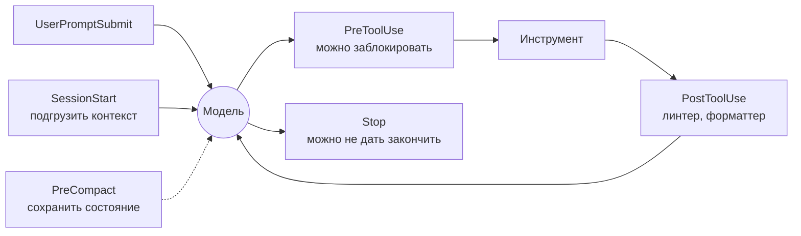
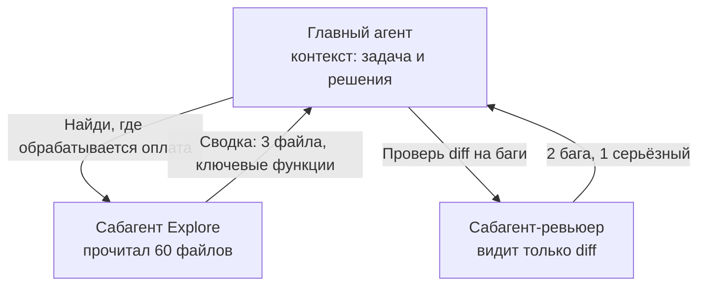

# 07 · Хуки, плагины, сабагенты

> [!abstract] 🎯 Что вынесешь
> Три механизма, которые превращают «умный чат» в управляемую систему:
> - **хуки** — гарантированные действия на события (не просьба, а код);
> - **сабагенты** — отдельные агенты с чистым контекстом для шумных или параллельных задач;
> - **плагины** — упаковка скиллов, агентов, хуков и MCP в один устанавливаемый модуль.
>
> Примеры — на Claude Code (самая подробная публичная документация). У Codex, Gemini CLI, OpenCode, Hermes есть аналоги с похожей логикой.

---

## 1. Хуки: промпт просит, хук гарантирует

**Хук** — команда (скрипт, HTTP-запрос, вызов MCP-инструмента, промпт или сабагент), которую харнесс запускает **автоматически** на событие жизненного цикла. Модель хук не выбирает и не может «забыть».



### Самые полезные события

| Событие | Когда | Типичное применение |
|---------|-------|---------------------|
| `SessionStart` | старт / возобновление | подгрузить git status, задачи, свежие скиллы команды |
| `UserPromptSubmit` | до обработки твоего сообщения | добавить контекст, отклонить запрос с секретом |
| `PreToolUse` | перед вызовом инструмента | **заблокировать** опасную команду, поправить аргументы |
| `PostToolUse` | после успешного вызова | форматтер/линтер после правки файла |
| `Stop` | агент хочет закончить ход | **не отпускать**, пока тесты красные |
| `SubagentStop` | сабагент закончил | проверить результат сабагента |
| `PreCompact` | перед сжатием контекста | сохранить прогресс в файл |
| `Notification` | агент ждёт тебя | уведомление в Telegram / системный звук |

### Протокол (command-хуки)

- На вход скрипт получает **JSON события в stdin** (`tool_name`, `tool_input`, `cwd`, `session_id` …).
- **exit 0** — всё хорошо; для некоторых событий stdout добавляется в контекст.
- **exit 2** — «стоп»: `PreToolUse` блокирует вызов, `Stop` не даёт закончить, `UserPromptSubmit` отклоняет промпт. Текст из **stderr** уходит модели как объяснение.
- **exit 1** и другие — *не блокируют*, только сообщают об ошибке.

> [!warning] Ловушка exit 1
> Привычный Unix-код ошибки `1` в хуках Claude Code **не блокирует** действие. Для запрета — только `exit 2` (или JSON с `permissionDecision: "deny"`).

### Конфигурация

```json
// .claude/settings.json (проект, в git) или ~/.claude/settings.json (лично)
{
  "hooks": {
    "PreToolUse": [
      { "matcher": "Bash|Read|Edit|Write",
        "hooks": [{ "type": "command",
                    "command": "python3 \"${CLAUDE_PROJECT_DIR}/.claude/hooks/guard.py\"" }] }
    ],
    "PostToolUse": [
      { "matcher": "Edit|Write",
        "hooks": [{ "type": "command", "command": "npx prettier --write \"$(jq -r .tool_input.file_path)\"" }] }
    ],
    "Stop": [
      { "hooks": [{ "type": "command",
                    "command": "python3 \"${CLAUDE_PROJECT_DIR}/.claude/hooks/verify_on_stop.py\"" }] }
    ]
  }
}
```

**Готовые и проверенные скрипты** в `templates/hooks/`:
- `guard.py` — блокирует `rm -rf`, force-push, `reset --hard`, `--no-verify`, `sudo`, `curl | sh` и чтение `.env`/ключей SSH;
- `verify_on_stop.py` — не даёт закончить, пока `pnpm check` (или твоя команда) красный; защищён от бесконечного цикла через `stop_hook_active`.

### Рецепты хуков, которые стоит иметь

| Задача | Событие | Идея |
|--------|---------|------|
| Автоформат | `PostToolUse` + `Edit\|Write` | prettier / ruff / gofmt по `file_path` |
| Типы и линтер после правки | `PostToolUse` | `tsc --noEmit` → ошибки в stderr модели |
| Защита папок | `PreToolUse` | запрет правок в `migrations/`, `generated/`, `vendor/` |
| «Готово = зелёное» | `Stop` | прогон тестов, exit 2 при провале |
| Контекст на старте | `SessionStart` | `git status`, текущая задача из трекера в stdout |
| Не потерять прогресс | `PreCompact` | дописать `progress.md` |
| Уведомления | `Notification` | `osascript -e 'display notification …'` или Telegram |

> [!danger] Хуки исполняются с твоими правами
> Это обычные shell-команды без песочницы. Читай чужие хуки (в том числе из плагинов) перед подключением.

---

## 2. Сабагенты: чистый контекст по требованию

**Сабагент** — отдельный экземпляр агента со **своим** контекстом, промптом, набором инструментов и, при желании, моделью. Главный агент даёт ему задачу и получает **только итоговую сводку**.



### Когда нужен сабагент

| ✅ Да | ❌ Нет |
|------|-------|
| исследование кода/веба, которое «зашумит» контекст | правка одного файла |
| параллельные независимые задачи | последовательные шаги, зависящие друг от друга |
| независимое ревью (свежий взгляд) | задачи, где нужно всё, что знает главный агент |
| дешёвая модель для механической работы | когда хватит одного `grep` |

### Главный урок индустрии: читать параллельно, писать в одну руку

Cognition (Devin) в 2025 году написала «Don't Build Multi-Agents»: параллельные агенты принимают **неявные решения** (стиль, крайние случаи, паттерны), и при одновременной записи эти решения конфликтуют. В 2026 году они уточнили, что работает:

- **Записи — однопоточные**, а дополнительные агенты вносят интеллект: исследуют, ревьюят, советуют.
- **Генератор ↔ ревьюер без общего контекста.** Ревьюер, который видит только diff, в их данных находит в среднем ~2 бага на PR, из них ~58% серьёзные. Чистый контекст = умнее (меньше «гниения контекста»).
- **«Умный друг».** Быстрая модель работает, а в трудный момент консультируется с дорогой — передавая ей форк полного контекста и задавая широкий вопрос «что мне делать?».

Anthropic в своей многоагентной исследовательской системе приводит экономику: агенты тратят ~4× токенов чата, многоагентные системы — ~15×. Значит, многоагентность оправдана только для дорогих по ценности задач.

### Сабагент в Claude Code

```markdown
<!-- .claude/agents/code-reviewer.md -->
---
name: code-reviewer
description: Independent reviewer. Use after a feature is implemented, before commit, to find bugs, security issues and missing tests in the diff.
tools: Read, Grep, Glob, Bash
model: inherit
---
You review a diff with fresh eyes. You did not write this code.
1. Run `git diff` and read every changed file fully.
2. Look for: logic errors, unhandled edge cases, security issues, missing tests.
3. Report findings by severity (critical / major / minor) with file:line and a concrete fix.
Report only real problems; style nits only if they hide bugs.
```

Полезные поля frontmatter: `tools` / `disallowedTools`, `model`, `skills` (предзагрузить скиллы), `mcpServers`, `hooks`, `maxTurns`, `isolation: worktree` (отдельная копия репозитория), `permissionMode`, `effort`.

### Как писать задачу сабагенту

Сабагент **ничего не знает** о вашем разговоре. Задание должно быть самодостаточным:

```text
Цель: найти все места, где сумма заказа считается на клиенте.
Контекст: Next.js-приложение, оплата в src/billing. Нас интересуют расхождения
с серверным расчётом (баг #412: клиент показывает 1999, сервер списывает 2099).
Не нужно: исправлять код.
Верни: список file:line + одной строкой, что там считается. Не больше 20 пунктов.
```

---

## 3. Плагины: упаковать и поделиться

**Плагин** — папка, которая объединяет скиллы, сабагентов, хуки и MCP-серверы под одним именем. Ставится одной командой, обновляется централизованно.

```
my-plugin/
├── .claude-plugin/
│   └── plugin.json        # имя, версия, описание
├── skills/
│   └── review/SKILL.md    # → /my-plugin:review
├── agents/
│   └── reviewer.md        # сабагент
├── hooks/
│   └── hooks.json         # хуки
└── .mcp.json              # MCP-серверы
```

```json
// .claude-plugin/plugin.json
{ "name": "my-plugin", "version": "0.1.0", "description": "Team review workflow" }
```

**Маркетплейс** — каталог плагинов (обычно git-репозиторий с `marketplace.json`):
```bash
/plugin marketplace add your-org/claude-plugins
/plugin install my-plugin@your-org
```

> [!tip] Когда упаковывать в плагин
> Подсказка из документации Claude Code: когда **второму репозиторию** нужна та же настройка. До этого держи всё в `.claude/` проекта — проще править.

Две философии распространения (хорошо видно на `mattpocock/skills`):
- **плагин** — управляемый, обновляется автором, ты «подписываешься»;
- **копия файлов** (`npx skills add …`) — ты владеешь скиллами и правишь их под себя.

---

## 4. Что куда класть: шпаргалка

| Нужно… | Механизм |
|--------|----------|
| Факт для каждой сессии («pnpm, не npm») | `AGENTS.md` / `CLAUDE.md` |
| Агент дважды ошибся в одной конвенции | строка в `AGENTS.md` |
| Повторяемая процедура или справочник | скилл |
| Стартовый промпт, который печатаешь снова и снова | ручной скилл (`/name`) |
| Правило, которое **никогда** нельзя нарушить | хук |
| Шумная разовая работа (поиск, анализ) | сабагент |
| Свежий взгляд на результат | сабагент-ревьюер без общего контекста |
| Доступ к внешней системе | MCP или CLI + скилл |
| Тон и формат всех ответов | output style / системный промпт |
| Та же настройка во втором проекте | плагин |

---

## 🧪 Практика (60 минут)

1. Скопируй `templates/hooks/guard.py` в `.claude/hooks/`, подключи в `.claude/settings.json`, попроси агента выполнить `rm -rf build`. Убедись, что он получил отказ и выбрал другой путь.
2. Подключи `verify_on_stop.py` со своей командой проверки. Сломай тест и попроси агента «закончить».
3. Создай сабагента `code-reviewer`. Сделай фичу в основной сессии, затем отдай diff ревьюеру. Сравни с самопроверкой основного агента.
4. Упакуй скилл из модуля 05 + ревьюера + хук в плагин и поставь его во второй проект.

## ✅ Чек-лист

- [ ] Знаю, что блокирует только exit 2
- [ ] Минимум один защитный хук и один проверочный хук в моих проектах
- [ ] Пишу задачи сабагентам самодостаточно
- [ ] Записи — в одну руку; параллельно — только чтение и ревью
- [ ] Понимаю структуру плагина и когда он нужен

---
← [[06 Инструменты и MCP]] · → [[08 Собираем свою агентную систему]] · 📖 [[11 Терминология]]
