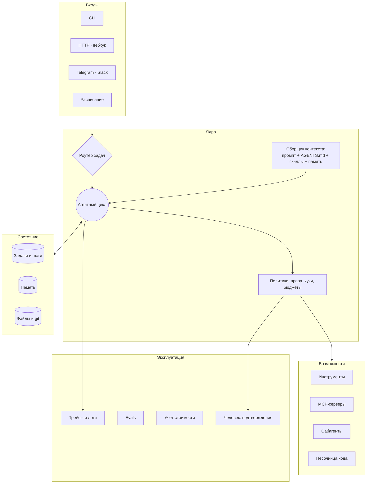
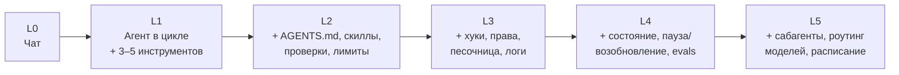

# 08 · Собираем свою агентную систему

> [!abstract] 🎯 Что вынесешь
> Пошаговый путь от `mini_agent.py` до системы, которой можно доверить реальную работу: архитектура, выбор фреймворка, состояние и память, оценка качества, наблюдаемость, стоимость, безопасность. В конце — чек-лист «готово к продакшену».

---

## 1. Сначала ответь на 6 вопросов

| Вопрос | Почему важно |
|--------|--------------|
| **Какую работу делает агент и для кого?** | без конкретной задачи получится «агент для всего», который не делает ничего хорошо |
| **Можно ли нарисовать путь блок-схемой?** | да → workflow (дешевле, надёжнее); нет → агент |
| **Как агент проверит себя?** | без проверки нет автономности: тесты, схемы, скриншоты, ревьюер |
| **Какие действия необратимы?** | там нужен человек или жёсткий хук |
| **Где живёт состояние?** | агент должен переживать перезапуск и сжатие контекста |
| **Сколько стоит одна задача и сколько она приносит?** | многоагентность в ~15× дороже чата — окупится ли? |

---

## 2. Эталонная архитектура

---

## 3. Двенадцать принципов надёжного агента

Сжатая версия [12-Factor Agents](https://github.com/humanlayer/12-factor-agents) (HumanLayer) с комментариями:

| # | Принцип | На практике |
|---|---------|-------------|
| 1 | Естественный язык → вызовы инструментов | главное умение LLM — превращать просьбу в структурированное действие |
| 2 | Владей своими промптами | промпты — файлы в git, а не спрятаны в фреймворке |
| 3 | Владей своим окном контекста | ты решаешь формат истории, а не библиотека |
| 4 | Инструменты — это просто структурированный вывод | вызов инструмента = JSON, который выполняет твой код |
| 5 | Объедини состояние выполнения и бизнес-состояние | шаги агента хранятся рядом с данными задачи |
| 6 | Запуск / пауза / продолжение простыми API | агент может ждать человека часами и продолжить |
| 7 | Связь с человеком — тоже инструмент | `ask_human(question)` как обычный tool call |
| 8 | Владей потоком управления | ветвления, ретраи, лимиты — в коде, а не в надежде на модель |
| 9 | Сжимай ошибки в контекст | краткая ошибка + подсказка, а не 500 строк трейсбека |
| 10 | Маленькие сфокусированные агенты | 3–20 шагов на агента; большие задачи — цепочкой |
| 11 | Запуск откуда угодно | там, где пользователь: чат, почта, CI |
| 12 | Агент как чистая функция (stateless reducer) | `(состояние, событие) → новое состояние`; легко тестировать и возобновлять |

---

## 4. Фреймворк или своё ядро?

| Вариант | Когда | Плюсы | Минусы |
|---------|-------|-------|--------|
| **Своё ядро** (как `mini_agent.py`) | учёба, узкая задача, максимум контроля | понимаешь каждую строку | всё (ретраи, стриминг, сжатие) пишешь сам |
| **[Claude Agent SDK](https://code.claude.com/docs/en/agent-sdk/overview)** | нужен «Claude Code внутри твоего приложения» | готовые инструменты, скиллы, хуки, сабагенты, сжатие | привязка к Claude |
| **[OpenAI Agents SDK](https://openai.github.io/openai-agents-python/)** | мультиагентные хенд-оффы, guardrails, трейсинг | лёгкий, провайдер-агностичный режим | своя модель абстракций |
| **[Pydantic AI](https://ai.pydantic.dev/)** | Python, строгие типы и структурированный вывод | типобезопасность, разные провайдеры | меньше готовых «агентных» инструментов |
| **[LangGraph](https://docs.langchain.com/oss/python/langgraph/overview)** | сложные графы состояний, долгие процессы с паузами | персистентность, человек-в-цикле | порог входа, много абстракций |
| **Готовый харнесс** (Claude Code / Codex / Hermes) + скиллы, хуки, MCP | личная продуктивность, команда разработки | 90% уже сделано | меньше контроля над ядром |

> [!tip] Совет
> Начни с готового харнесса и **настрой его** скиллами, хуками и MCP — это и есть «своя агентная система» для 80% случаев. Своё ядро пиши, когда агент становится частью продукта или нужна особая логика управления.

---

## 5. Путь развития: от скрипта к системе

Не перепрыгивай уровни. Каждый следующий имеет смысл, только когда предыдущий работает стабильно.

### Как развить `mini_agent.py` (упражнения по порядку)

1. **Инструмент `edit_file(path, old, new)`** — точечная замена вместо полной перезаписи. Проверка: `old` встречается ровно один раз, иначе ошибка с подсказкой.
2. **Загрузка `AGENTS.md`** из рабочей папки в системный промпт.
3. **Скиллы:** при старте прочитать `skills/*/SKILL.md`, положить в промпт только `name + description`, добавить инструмент `load_skill(name)`.
4. **Журнал:** каждый шаг — строка JSONL (`step, tool, args, result_len, tokens, ms`).
5. **Бюджет:** остановка по токенам/деньгам, а не только по шагам.
6. **Хуки:** функции `pre_tool(name, args)` / `post_tool(...)` с возможностью отказа.
7. **Состояние:** сохранять `messages` в файл после каждого шага, флаг `--resume`.
8. **Сабагент:** инструмент `delegate(task)`, который запускает `agent()` с чистой историей и возвращает только итог.

После этих 8 шагов у тебя будет понимание каждого механизма, о которых шла речь в курсе.

---

## 6. Оценка качества (evals) — без них ты гадаешь

| Уровень | Что проверяем | Как |
|---------|---------------|-----|
| **Юнит** | инструмент работает | обычные тесты кода |
| **Шаг** | модель выбирает правильный инструмент с правильными аргументами | 20–50 ситуаций → ожидаемый вызов |
| **Задача** | агент доводит задачу до результата | набор реальных задач + проверка результата кодом |
| **Траектория** | путь разумный: без лишних шагов, без опасных действий | анализ логов, LLM-судья по рубрике |
| **Регрессия** | новая модель/промпт ничего не сломали | прогон всего набора на каждое изменение |

**Правила:**
- Проверяй результат **кодом** везде, где можно (тест прошёл, файл существует, JSON валиден). LLM-судья — только для того, что кодом не проверить, и с чёткой рубрикой.
- Набор задач — из **реальных провалов**. Каждый баг агента → новый тест.
- Смотри на **распределение** (5 прогонов на задачу), а не на один удачный запуск.

---

## 7. Наблюдаемость и стоимость

Логируй на каждый шаг: модель, входные/выходные токены, инструмент, аргументы, длину результата, время, ошибку. Этого достаточно, чтобы ответить на главные вопросы: *где агент тратит деньги, где тупит, где ошибается*.

**Как снижать стоимость:**
- **Кэширование промпта** (prompt caching): стабильная часть (системный промпт, инструменты, `AGENTS.md`) — в начале и без изменений, тогда провайдер кэширует её и берёт заметно дешевле. Не вставляй время/дату/случайные ID в начало промпта — это ломает кэш.
- **Роутинг моделей:** дешёвая модель — поиск и механика; дорогая — планирование, ревью, трудные места.
- **Короткие ответы инструментов** и сабагенты для шумной работы.
- **Effort по задаче**, а не максимальный всегда.
- **Batch API** для неинтерактивных массовых задач.

---

## 8. Безопасность: минимальный набор

- [ ] Песочница (контейнер / VM / отдельный пользователь), без доступа к `~` и секретам
- [ ] Секреты через переменные окружения/хранилище, **никогда** в промпте и логах
- [ ] Права инструментов минимальные; запись и сеть — по allowlist
- [ ] Необратимые действия — только с подтверждением человека
- [ ] Хуки-охранники на опасные команды и пути
- [ ] Проверена «смертельная триада» ([[06 Инструменты и MCP]])
- [ ] Лимиты: шаги, токены, деньги, время
- [ ] Аудит-лог всех действий

---

## 9. Чек-лист «готово к реальной работе»

- [ ] Агент решает **конкретную** задачу, есть 20+ eval-задач с проверкой кодом
- [ ] Успешность на eval-наборе стабильна на 5 прогонах
- [ ] Каждый шаг логируется, стоимость задачи известна
- [ ] Агент переживает перезапуск (состояние вне памяти процесса)
- [ ] Ошибки инструментов возвращаются модели, ретраи — в коде
- [ ] Человек может остановить, подтвердить, поправить
- [ ] Безопасность по чек-листу выше
- [ ] Промпты, скиллы, хуки — в git, с версиями

---

## 🧪 Практика (2–4 часа)

Выполни 8 упражнений из раздела 5 на `mini_agent.py`. Это главный практический блок курса: после него ты сможешь читать исходники любого харнесса и понимать, что там происходит.

---
← [[07 Хуки, плагины, сабагенты]] · → [[09 Продвинутый вайбкодинг]] · 📖 [[11 Терминология]]
