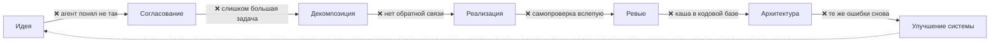
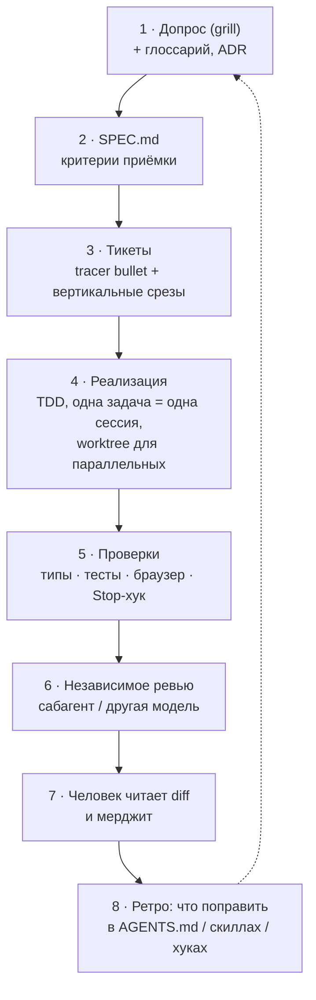

# 09 · Продвинутый вайбкодинг: паттерны 2026

> [!abstract] 🎯 Для кого
> Для тех, кто уже ежедневно пишет код с агентом и упёрся в потолок: агент делает «не то», код превращается в кашу, долгие задачи разваливаются, ревью съедает всё сэкономленное время. Здесь собраны приёмы, которыми сейчас работают сильные агентные инженеры, — с источниками.

> [!quote] Сдвиг мышления
> **Вайбкодинг** — «описал → принял, не глядя». **Агентная инженерия** — ты проектируешь среду, в которой агент не может сделать плохо незаметно. Ты сидишь **на** цикле, а не **в** нём.

---

## 0. Карта: где теряется качество



Каждый раздел ниже закрывает одну стрелку.

---

## 1. Согласование: допрос перед кодом (grilling)

**Проблема.** Самый частый провал — несовпадение того, что ты имел в виду, и того, что понял агент. Ты думаешь, что всё ясно, пока не увидишь результат.

**Паттерн.** Перед любой нетривиальной задачей агент **допрашивает тебя**: по одному вопросу за раз, с рекомендованным вариантом ответа, до тех пор, пока не останется неясностей. Популяризован скиллом `/grill-me` Мэтта Покока — одним из самых устанавливаемых скиллов.

```text
Допроси меня по этой задаче. Задавай по одному вопросу, к каждому — твой
рекомендуемый ответ и почему. Иди по дереву решений: сначала то, от чего
зависят остальные ответы. Если ответ можно найти в коде — найди сам, не спрашивай.
Остановись, когда сможешь написать спецификацию без допущений.
```

**Усиление — общий язык (ubiquitous language).** В процессе допроса агент ведёт `GLOSSARY.md` / `CONTEXT.md` с терминами проекта, а важные решения записывает в ADR. Эффект: вместо «проблема, когда урок внутри раздела курса получает место в файловой системе» — «проблема в materialization cascade». Агент тратит меньше токенов, имена в коде становятся последовательными, навигация — проще.

---

## 2. Спецификация как источник правды (spec-driven development)

**Паттерн.** Код — производное от спецификации. Цепочка:

```
допрос → SPEC.md (что и зачем) → PLAN.md (как) → тикеты → реализация → проверка по спеке
```

- **SPEC** — поведение и критерии приёмки, без кода. Пишется для человека и агента.
- **PLAN** — модули, интерфейсы, порядок, риски.
- **Тикеты** — вертикальные срезы, каждый проверяем отдельно.

Инструменты: [GitHub Spec Kit](https://github.com/github/spec-kit) (`/specify → /plan → /tasks → /implement`), скиллы `to-spec` и `to-tickets` у Мэтта Покока, методология [Superpowers](https://github.com/obra/superpowers) (brainstorm → plan → subagent-driven development).

> [!tip] Тяжёлые фреймворки против маленьких скиллов
> Spec Kit, BMAD, GSD берут процесс на себя — удобно на старте, но трудно чинить, когда процесс ломается. Альтернатива — маленькие композиционные скиллы, которые ты понимаешь и правишь. Опытные инженеры чаще выбирают второе.

---

## 3. Декомпозиция: трассирующие пули и вертикальные срезы

**Проблема.** «Сделай систему авторизации» — агент пишет 2000 строк, половина не работает, контекст кончился.

**Паттерн «tracer bullet».** Первый тикет — самый тонкий **сквозной** путь через все слои (UI → API → БД → ответ), пусть с заглушками. Он сразу показывает, что архитектура «стреляет». Дальше каждый тикет — вертикальный срез, который можно проверить и закоммитить.

| ❌ Горизонтально | ✅ Вертикально |
|-----------------|---------------|
| 1. Все модели БД 2. Все API 3. Весь UI | 1. Вход по email: форма → API → БД → редирект 2. Восстановление пароля 3. OAuth Google |

**Правило размера:** тикет = одна сессия агента в «умной зоне» контекста. Практики Ralph-цикла говорят, что качество держится, пока контекст заполнен примерно на **40–60%**; из заявленных 200K реально полезны ~176K.

---

## 4. Обратная связь: «скорость обратной связи — это твой предел скорости»

**Проблема.** Без обратной связи агент летит вслепую и говорит «готово» на основании того, что код *выглядит* правильно.

**Паттерн — backpressure (противодавление).** Окружи агента автоматическими проверками, которые **отклоняют** плохую работу:

| Проверка | Ловит |
|----------|-------|
| Строгие типы | несовместимые интерфейсы, опечатки в полях |
| Тесты **red → green → refactor** | логические ошибки; тест пишется *до* кода и сначала падает |
| Линтер + форматтер (в хуке) | стиль и простые баги — без споров |
| Браузер (Playwright / DevTools MCP) | «работает в коде, но не на экране» |
| Скриншот-сравнение с макетом | дизайн разъехался |
| LLM-судья с бинарной рубрикой | субъективное: тон текста, UX, эстетика |

**Ключевой приём — TDD с агентом:**
```text
Сначала напиши ОДИН падающий тест на поведение из тикета и запусти — покажи, что он красный.
Затем минимальный код, чтобы он стал зелёным. Затем рефакторинг при зелёных тестах.
Тесты проверяют поведение через публичный интерфейс, не детали реализации.
```

И закрепи это хуком: `Stop` не отпускает агента, пока проверка красная ([[07 Хуки, плагины, сабагенты]]).

---

## 5. Независимое ревью: генератор ↔ проверяющий

**Паттерн.** Код пишет один агент, проверяет **другой, без общего контекста** — он видит только diff и задачу. Cognition сообщает, что такая петля находит в среднем ~2 бага на PR, ~58% из них серьёзные, даже когда код написан той же моделью. Причины: чистый контекст = меньше гниения внимания; ревьюер вынужден восстанавливать намерение по коду и замечает расхождения.

**Как устроить:**
1. сабагент `code-reviewer` с инструментами только на чтение;
2. отчёт по серьёзности: critical / major / minor, с `file:line`;
3. **важно:** главный агент фильтрует замечания с учётом всего контекста задачи (иначе бесконечные циклы «исправь → новое замечание»);
4. лимит: максимум 2–3 круга.

**Вариант — разные модели:** писать одной, ревьюить другой (например, Claude ↔ GPT). Разные «слепые пятна» дополняют друг друга.

---

## 6. Долгая автономия: Ralph-цикл

**Паттерн Джеффри Хантли.** Один и тот же промпт подаётся агенту в бесконечном цикле, **каждый раз с чистым контекстом**:

```bash
while :; do cat PROMPT.md | claude -p --dangerously-skip-permissions; done
```

Каждая итерация: прочитать `specs/` + `IMPLEMENTATION_PLAN.md` + `AGENTS.md` → выбрать **одну** самую важную задачу → сделать → прогнать проверки → закоммитить → обновить план → выйти.

**Почему работает:** каждая итерация в «умной зоне» контекста; состояние живёт в файлах и git, а не в памяти модели; противодавление тестов не даёт накапливаться мусору.

**Принципы из плейбука:**
- **Главный контекст — планировщик**, тяжёлую работу делают сабагенты (их контекст «собирается сборщиком мусора»).
- **Направляй сверху** (спеки, существующие паттерны кода) и **снизу** (тесты, типы, линтер).
- **Сиди на цикле, а не в нём:** наблюдай, где агент ошибается, и правь промпт, спеки и `AGENTS.md`, а не код.

> [!danger] Только в песочнице
> Автономный режим без подтверждений = песочница — твоя **единственная** граница безопасности. Docker / удалённая VM, минимум ключей, ограниченная сеть. «Вопрос не *если* агента взломают, а *когда* — и какой радиус поражения».

---

## 7. Параллельная работа: worktrees и «одна рука на запись»

**Паттерн.** Несколько агентов параллельно — каждый в своём **git worktree** (отдельная рабочая копия на своей ветке). Ты — оркестратор и ревьюер.

```bash
git worktree add ../app-auth -b feat/auth
git worktree add ../app-billing -b feat/billing
# в каждой папке — своя сессия агента
```

**Правила:**
- параллелить **независимые** тикеты (разные модули);
- решения, которые касаются нескольких тикетов (схема, имена, API), **принимаешь ты заранее** и вписываешь в каждый тикет — иначе агенты примут их по-разному;
- узкое место смещается в ревью → автоматизируй его (раздел 5).

---

## 8. Архитектура, которую понимает агент (agent-legible codebase)

**Проблема.** Агенты ускоряют энтропию: кодовая база усложняется с беспрецедентной скоростью.

**Паттерны:**
- **Глубокие модули** (Джон Оустерхаут): простой интерфейс, много функциональности внутри. Агенту достаточно прочитать интерфейс, а не весь модуль.
- **Явные границы:** у каждого модуля свой `README.md`/вложенный `AGENTS.md`, публичный API через один `index`, внутренности не импортируются снаружи. Можно закрепить линтером зависимостей (например, dependency-cruiser) — агент получит ошибку, а не «тихо» нарушит архитектуру.
- **Последовательные паттерны:** агент копирует то, что видит. Плохой паттерн в кодовой базе размножится. Один хороший эталонный модуль работает лучше страницы правил.
- **Регулярный обзор:** раз в несколько дней — «найди места, где модули стоит углубить; предложи кандидатов, не переписывай».

---

## 9. Чинить систему, а не результат

Самая важная привычка. Агент ошибся → спроси себя: **какое изменение среды сделало бы эту ошибку невозможной или маловероятной?**

| Ошибка повторилась | Исправление системы |
|--------------------|---------------------|
| забыл конвенцию | строка в `AGENTS.md` |
| не следует процедуре | скилл с критериями готовности |
| нарушает правило «иногда» | хук |
| выдумывает API библиотеки | MCP документации / `llms.txt` / ссылка в скилле |
| ломает архитектуру | линтер зависимостей в CI + хук |
| делает «не то» | допрос перед задачей |
| «готово», но не работает | Stop-хук с проверкой + ревьюер |

После каждой трудной задачи: «Что в наших скиллах и `AGENTS.md` не хватило? Предложи минимальный diff». Самообучающиеся агенты (например, Hermes) делают это автоматически.

---

## 10. Мелочи, которые дают много

- **Начинай с режима плана** (plan mode) для любой задачи больше 30 минут: сначала план, потом код.
- **`/clear` чаще, чем кажется нужным.** Новая задача — новый контекст.
- **Покажи, а не описывай:** скриншот бага, пример желаемого вывода, эталонный файл.
- **Попроси агента объяснить план своими словами** перед стартом — дешёвая проверка понимания.
- **Коммиты маленькие и частые:** откат на шаг дешевле, чем разбор каши.
- **Не спорь с агентом 10 сообщений** — откати, уточни промпт, начни заново.
- **Голосовой ввод:** надиктовать контекст на 2 минуты быстрее, чем печатать, и он получается полнее.
- **Читай diff, а не сообщения агента.** «Я исправил баг» — утверждение; diff — факт.
- **Генерируй дизайн-документы и схемы как HTML/Mermaid** — проверять визуально быстрее, чем текст.
- **Два агента на сложное решение:** попроси два разных подхода в двух сессиях и выбери.
- **Дешёвая модель для разведки, дорогая для решений.**
- **Держи «журнал провалов»:** каждая повторяющаяся ошибка агента — кандидат в скилл, хук или правило.

---

## 🧭 Рабочий цикл опытного агентного инженера



---

## 🧪 Практика (1 рабочий день)

Возьми реальную фичу среднего размера и проведи её по циклу выше:
1. допрос (сохрани вопросы и ответы) → `SPEC.md`;
2. 3–6 тикетов, первый — tracer bullet;
3. каждый тикет — отдельная сессия, TDD, коммит;
4. ревью сабагентом без общего контекста;
5. ретро: минимум одно изменение в `AGENTS.md`, скилле или хуке.

## ✅ Чек-лист

- [ ] Перед нетривиальной задачей — допрос, а не «сделай X»
- [ ] Есть спецификация с критериями приёмки
- [ ] Тикеты — вертикальные срезы, каждый помещается в одну сессию
- [ ] Типы, тесты, браузер и Stop-хук создают противодавление
- [ ] Ревью делает агент без общего контекста
- [ ] Параллельные агенты — в worktree, общие решения принимаю я
- [ ] После каждой ошибки чиню систему, а не только код

---
← [[08 Собираем свою агентную систему]] · → [[10 UI-UX с ИИ]] · 📖 [[11 Терминология]]
