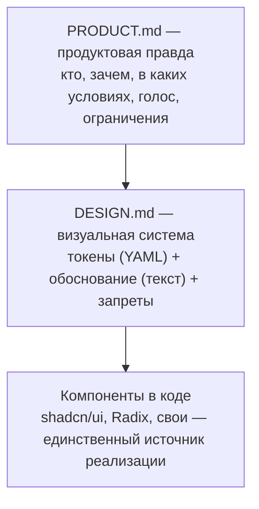
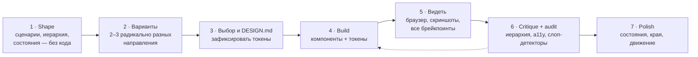

# 10 · UI/UX современных систем с помощью ИИ

> [!abstract] 🎯 Что вынесешь
> Почему ИИ по умолчанию рисует одинаковые интерфейсы и как это исправить: продуктовый контекст, дизайн-система в `DESIGN.md`, дизайн-скиллы, визуальная проверка в браузере, итерации вариантами. Плюс конвейер «идея → макет → код → полировка» и список ресурсов.

---

## 1. Проблема: «ИИ-слоп» в интерфейсах

Модели обучены на одних и тех же SaaS-шаблонах. Без указаний получаются одни и те же признаки:

- шрифт Inter (или Roboto, системный) везде;
- фиолетово-синий градиент на белом;
- карточки внутри карточек;
- серый текст на цветном фоне;
- иконка в скруглённом цветном квадрате над каждым заголовком;
- герой-блок «Заголовок + подзаголовок + две кнопки + скриншот в рамке»;
- три карточки с фичами в ряд;
- эмодзи вместо иконок и бессмысленные анимации появления.

Anthropic называет причину **distributional convergence**: модель тянется к самому вероятному варианту. Её собственный совет дизайнерам промптов: модель *всё равно* будет сходиться к популярным решениям (даже к «нестандартному» Space Grotesk) — нужны явные, конкретные решения, а не «сделай красиво».

> [!tip] Главная мысль модуля
> Хороший UI от ИИ — это **не лучший промпт**, а **лучший контекст**: кто пользователь, какой характер у продукта, какие токены, какие компоненты, что запрещено, и чем проверять результат.

---

## 2. Три слоя дизайн-контекста



### 2.1 `PRODUCT.md` — зачем и для кого

Подход из дизайн-скилла [Impeccable](https://impeccable.style/): отделить **долгую правду о продукте** от визуального направления.

```markdown
## Audience     — кто, уровень опыта, частота использования
## Job          — какую работу выполняет продукт (одной фразой)
## Context      — где и как используют: десктоп в офисе? телефон на бегу? 8 часов в день?
## Voice        — тон текстов: сухой и точный / тёплый / игривый
## Constraints  — доступность, языки, бренд, тёмная тема, платформа
## Evidence     — что мы знаем о пользователях (интервью, метрики)
```

**Почему это важно:** «ежедневный инструмент для бухгалтера» и «лендинг для геймеров» требуют противоположных решений — плотности, контраста, движения. Без этого файла модель выбирает «среднее».

### 2.2 `DESIGN.md` — визуальная система для агента

Открытый формат Google Stitch (март 2026): **YAML-токены** (точные значения) + **markdown-обоснование** (почему и как применять). Агенты (Claude Code, Cursor, Gemini CLI и др.) читают его как контекст при генерации UI.

Разделы — строго в этом порядке (любой можно опустить):

| # | Раздел | Что писать |
|---|--------|-----------|
| 1 | **Overview** | характер в 2–3 предложениях, метафора («хороший бумажный блокнот») |
| 2 | **Colors** | семантические имена + HEX + роль: `primary`, `surface`, `danger` |
| 3 | **Typography** | семейства и шкала: display, h2, body, label |
| 4 | **Layout** | сетка, ширина колонки, брейкпоинты |
| 5 | **Elevation & Depth** | тени или границы, уровни слоёв |
| 6 | **Shapes** | радиусы и где какие |
| 7 | **Components** | кнопки, карточки, поля, состояния |
| 8 | **Do's and Don'ts** | ограничители для агента |

Готовый пример, прошедший официальный линтер без замечаний: `templates/DESIGN.md`.

```bash
npx @google/design.md lint DESIGN.md                 # битые ссылки на токены, контраст WCAG, структура
npx @google/design.md diff DESIGN.md DESIGN-v2.md    # регрессии между версиями дизайн-системы
```

> [!tip] Не с нуля
> - Stitch извлекает `DESIGN.md` из существующего сайта по URL.
> - [awesome-design-md](https://github.com/VoltAgent/awesome-design-md) — `DESIGN.md` десятков известных брендов (Stripe, Linear, Vercel…) как отправная точка — **не копируй бренд целиком**, бери приёмы.
> - `/impeccable document` генерирует `DESIGN.md` из кода уже существующего проекта.

### 2.3 Компоненты — единственный источник реализации

- **[shadcn/ui](https://ui.shadcn.com/)** — компоненты копируются в проект как код (ты владеешь ими); на базе **[Radix](https://www.radix-ui.com/)** (доступность из коробки) и **[Tailwind](https://tailwindcss.com/)**. Модели знают его очень хорошо — это плюс (меньше ошибок) и минус (всё выглядит как shadcn по умолчанию). **Перекрась токены под свой `DESIGN.md`** — и это уже твой продукт.
- Правило для `AGENTS.md`: «Новые UI-элементы собирай из `src/components/ui`. Новый базовый компонент — только после обсуждения».

---

## 3. Дизайн-скиллы: дать агенту вкус и словарь

| Скилл / инструмент | Что даёт |
|--------------------|----------|
| [frontend-design](https://github.com/anthropics/claude-code/blob/main/plugins/frontend-design/skills/frontend-design/SKILL.md) (Anthropic) | первый массовый дизайн-скилл: смелое направление, типографика, цвет, движение, запрет клише |
| [Impeccable](https://github.com/pbakaus/impeccable) | 1 скилл, ~24 команды (`shape`, `craft`, `critique`, `audit`, `polish`, `bolder`, `quieter`, `distill`, `harden`, `typeset`, `layout`, `animate`…) + ~60 детерминированных детекторов «ИИ-слопа» без LLM |
| [vercel-labs/agent-skills](https://github.com/vercel-labs/agent-skills) | React/Next.js: правила производительности, принципы веб-дизайна |
| Свой скилл | твой `DESIGN.md` + эталонные экраны + чек-лист полировки |

**Ключевая идея — общий словарь.** Вместо «сделай получше» ты говоришь «`quieter` для дашборда, `typeset` для заголовков, `harden` для форм». Каждая команда — проверенная процедура. Это тот же принцип ведущих слов из [[05 Скиллы]].

Сниппет из официального гайда Anthropic (сокращённо), который можно положить в системный промпт или скилл:

```xml
<frontend_aesthetics>
You tend to converge toward generic, "on distribution" outputs. Make creative,
distinctive frontends. Typography: distinctive font choices, not Inter/Roboto/Arial.
Color: commit to a cohesive palette via CSS variables; dominant colors with sharp accents.
Motion: one well-orchestrated page load with staggered reveals beats scattered micro-interactions.
Backgrounds: create atmosphere and depth rather than flat defaults.
Avoid clichéd purple gradients on white and cookie-cutter layouts.
</frontend_aesthetics>
```

> [!warning] Не путай «смело» с «хорошо»
> Для продуктовых интерфейсов (дашборды, админки, рабочие инструменты) нужна не «удивительная эстетика», а ясность, плотность и предсказуемость. Скилл и `PRODUCT.md` должны говорить модели, какой это режим: **маркетинг** (характер, эмоция) или **инструмент** (скорость работы, иерархия, состояния).

---

## 4. Конвейер: идея → макет → код → полировка



### Шаг 1. Shape — UX до UI

Попроси агента **не рисовать**, а описать:
- главную задачу пользователя на экране и путь к ней в минимум шагов;
- иерархию: что видно первым, вторым, третьим;
- **все состояния**: пусто, загрузка, ошибка, частичные данные, очень длинный текст, нет прав;
- что происходит на телефоне.

### Шаг 2. Варианты, а не один ответ

```text
Предложи 3 радикально разных направления для этого экрана — разная компоновка,
плотность и характер, не вариации одного макета. Для каждого: одна строка идеи,
кому подходит, чем рискует. Сделай каждое как отдельный HTML-файл.
```

Модели особенно хорошо сравнивать **рядом**. Быстрые HTML-наброски дешевле, чем переделка готового кода. Для раннего этапа подходят [Google Stitch](https://stitch.withgoogle.com/), [v0](https://v0.app/), [Claude Design](https://support.claude.com/en/articles/14604416-get-started-with-claude-design), [21st.dev](https://21st.dev/) (каталог компонентов + MCP), Figma с MCP.

### Шаг 3–4. Зафиксировать и собрать

Выбранное направление → `DESIGN.md` → код только через токены (CSS-переменные / Tailwind theme). Любой «магический» HEX в компоненте — повод для правки.

### Шаг 5. Агент должен видеть результат

Это **самый недооценённый шаг**. Без него агент проверяет UI по коду — то есть никак.

- [Playwright MCP](https://github.com/microsoft/playwright-mcp) или [Chrome DevTools MCP](https://github.com/ChromeDevTools/chrome-devtools-mcp): открыть страницу, кликнуть, сделать скриншоты на 375 / 768 / 1280 / 1920 px, проверить консоль.
- Попроси сравнить скриншот с макетом и перечислить расхождения **списком**, а потом исправить.
- Figma MCP: агент берёт реальные переменные и компоненты из макета, а не угадывает по картинке.

### Шаг 6. Критика и аудит

```text
Сделай критику экрана как старший продуктовый дизайнер:
1) что пользователь видит первым и правильно ли это;
2) где иерархия спорит сама с собой;
3) какие признаки «ИИ-шаблона» видны;
4) a11y: контраст, фокус, клавиатура, подписи полей;
Каждое замечание — с конкретным исправлением. Отсортируй по влиянию.
```

Детерминированная часть — автоматом: `npx @google/design.md lint`, Lighthouse/axe для доступности, детекторы Impeccable.

### Шаг 7. Полировка: то, что отличает продукт от демо

- [ ] Пустые, загрузочные, ошибочные состояния спроектированы
- [ ] Длинные строки, переводы, большие числа не ломают раскладку
- [ ] Фокус видим, всё доступно с клавиатуры, контраст ≥ 4.5:1
- [ ] Числа в таблицах — табличные цифры, выравнивание по правому краю
- [ ] Движение подчёркивает смысл (появление, переход), уважает `prefers-reduced-motion`
- [ ] Тексты интерфейса конкретны: «Сохранить отчёт», а не «Отправить»
- [ ] Тёмная тема — отдельно проверенная палитра, а не инверсия
- [ ] Одно главное действие на экран

---

## 5. Секреты, которые дают максимум

1. **Референсы сильнее прилагательных.** «Плотность как в Linear, типографика как в хорошем журнале, тёплая бумажная палитра» лучше, чем «современный минималистичный дизайн». Источник реальных паттернов: [Mobbin](https://mobbin.com/).
2. **Запрет + позитивная цель вместе.** Не только «без фиолетовых градиентов», но и «одна акцентная терракота на тёплом бумажном фоне».
3. **Ограничь палитру и шкалу.** 1 акцент, 4 стиля текста, 5 отступов. Меньше вариантов = меньше хаоса.
4. **Эталонный экран.** Один экран, доведённый до идеала руками, — лучший промпт для всех остальных: «делай как `/settings`».
5. **Скриншот → список → правка.** Не «поправь дизайн», а «перечисли 10 расхождений со скриншотом, потом исправь по одному».
6. **Дизайн-ревью отдельным агентом** без контекста реализации — тот же принцип, что в коде.
7. **Сначала UX-текст.** Напиши реальные тексты интерфейса до вёрстки — lorem ipsum скрывает проблемы иерархии.
8. **Проверяй на реальных данных:** длинные имена, 0 и 10 000 элементов, медленная сеть.
9. **Движение — одно хорошее, а не десять случайных.** Ориентир — [Motion](https://motion.dev/) для React или CSS-only.
10. **Основы никуда не делись.** [Refactoring UI](https://refactoringui.com/) и [Laws of UX](https://lawsofux.com/) — лучшая база, которую стоит знать самому, чтобы оценивать работу ИИ.

---

## 🧪 Практика (2 часа)

1. Напиши `PRODUCT.md` для своего проекта (6 разделов, по 2–3 строки).
2. Возьми `templates/DESIGN.md`, замени на свои токены, прогони `npx @google/design.md lint`.
3. Попроси агента 3 направления для главного экрана как HTML. Выбери одно.
4. Собери экран, подключи Playwright MCP, сделай скриншоты на 3 ширинах и критику по шаблону из шага 6.
5. Пройди чек-лист полировки.

## ✅ Чек-лист

- [ ] У проекта есть `PRODUCT.md` и `DESIGN.md`, линтер чистый
- [ ] Компоненты используют только токены
- [ ] Агент проверяет UI в браузере, а не по коду
- [ ] Всегда смотрю 2–3 варианта перед выбором направления
- [ ] Все состояния и крайние случаи спроектированы
- [ ] Знаю признаки «ИИ-слопа» и ловлю их до релиза

---
← [[09 Продвинутый вайбкодинг]] · → [[11 Терминология]] · 🔗 [[12 Библиотека ссылок]]
